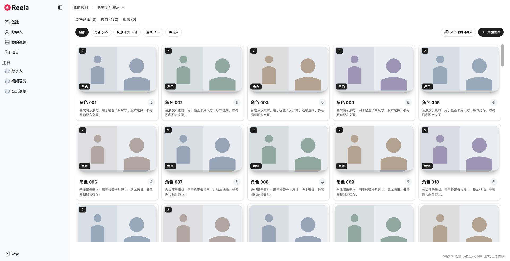
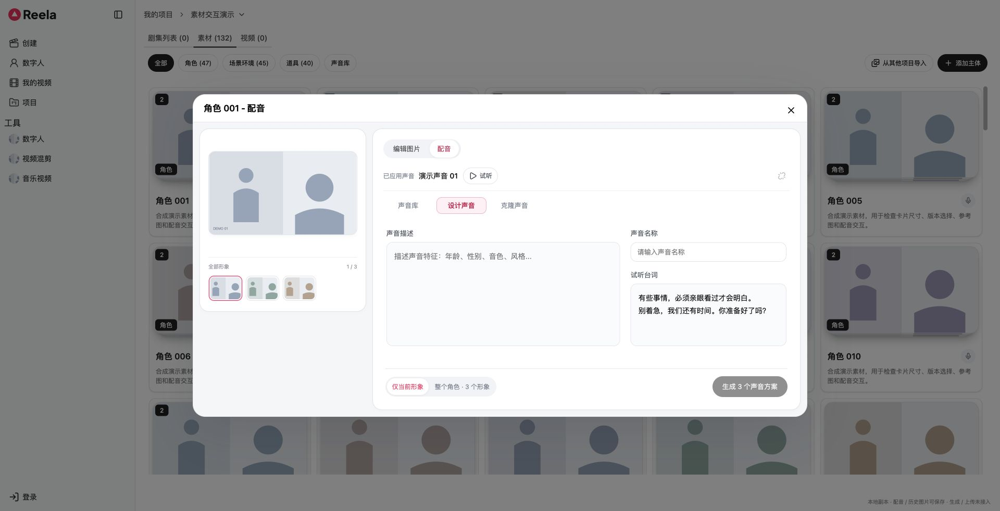

# Reela Subjects UI

主体素材页的前端交接仓库：B「结果并列」图片布局、02「描述优先」配音布局，宽屏每行最多5张卡片。

## 直接运行

Node.js 18+，不需要安装依赖：

```sh
git clone https://github.com/Wanghaoye007/reela-subjects-ui.git
cd reela-subjects-ui
npm start
```

打开 http://127.0.0.1:8920/projects/p_demo_subjects?tab=subjects&study=results&voiceLayout=focus 。停止服务按Ctrl+C。端口占用时可设置`REELA_PREVIEW_PORT=8921`。

## 看什么

- `source/`：本次调整的前端组件、CSS及必要的多参考图server/worker/SDK接口代码，按原仓库路径组织。
- `source/apps/web/local-preview/`：Vite预览入口、配置、固定B/focus布局及模拟API。
- `preview/`：可独立运行的编译结果和本地演示图片/音频。
- `data/demo-fixture.json`：132个合成主体（108组）、24个合成声音。所有图片是本地SVG占位示例；试听音频是提示音，不是真人声音。
- `docs/INTEGRATION.md`：工程迁移与接口边界。
- `docs/screenshots/`：公开演示数据下的界面截图。
- `PUBLIC-MANIFEST.json`：公开源码清单和内容hash。

源码是对原monorepo的增量交接，**不是完整生产仓库**；`npm start`运行已编译的独立原型。编辑源码后重新构建需要原项目的私有工作区依赖，迁移方式见INTEGRATION。

## 推荐体验

悬停角色卡片观察叠层散开 → 点击角色001图片 → 切换形象/图片版本 → 多次“用作参考” → 添加/移除本地参考图 → 配音切换声音库/设计/克隆 → 查看右上角添加主体。

版本应用和声音绑定只写浏览器localStorage；真实生成、创建/导入、成品上传、设计/克隆声音尚未接入，会提示未接入。公开演示不含真实项目、素材URL、环境配置或原仓库Git历史。



